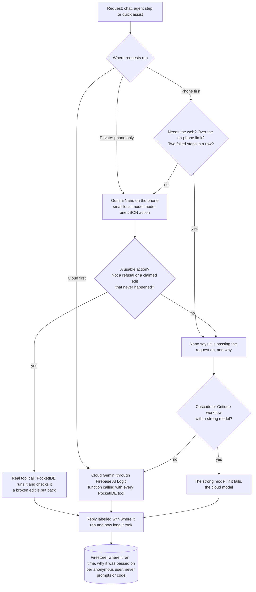

# PocketIDE Hybrid — Firebase #BuildHybridAI 2026

PocketIDE is a coding environment that runs on an Android phone: editor, terminal, git, previews and an AI agent.
This repository is the MIT edition of PocketIDE with **hybrid AI** added for the
[#BuildHybridAI hackathon](https://firebasehybridaihackathon.devpost.com/): quick coding help runs **on the phone with
Gemini Nano** through **Firebase AI Logic**, and falls back to a **cloud Gemini model** when Nano is missing,
the request is too long for it, or the person prefers the cloud.

## Try it

1. Install the APK from this repository's **Releases** page (the "judges' build"). It needs Android 8 or later; it is a debug
   build, so allow installing from your browser or file manager.
2. Open **Models → Hybrid AI**. The first time, "How hybrid AI works" explains the routing. Gemini Nano runs on phones that
   support it through Android AICore (for example recent Pixel and Samsung Galaxy S phones; tested on a Galaxy S24+); every
   other phone uses the cloud model automatically, and the screen says which.
3. Ask something in **Try it**. The reply says where it ran: `⚡ Ran on this phone (Gemini Nano)` or `☁ Ran in the cloud`.
4. To use it everywhere in PocketIDE, choose **Hybrid AI (Gemini Nano + cloud)** as the AI provider (Settings), then open a
   project and use the AI tab: chat, or the agent, which edits files, runs commands and checks its work.
5. Things to try: turn on airplane mode and ask again (Nano still answers); turn on **Private** (nothing leaves the phone); ask
   for research ("research meal-planning apps on GitHub"): Nano says it is passing the request to the cloud, and why.

## How it works

Firebase products used: **AI Logic** (hybrid inference, on-device Gemini Nano and cloud Gemini with function calling),
**App Check**, **Remote Config** (cloud model, on-phone limit, default routing, a switch that turns the cloud off),
**Authentication** (anonymous), **Firestore** (usage summary), **Crashlytics** and **Performance Monitoring** (traces
`hybrid_phone`, `hybrid_chat`, `hybrid_cloud`).

## What was there before the hackathon

The first commit (`Baseline: PocketIDE MIT edition 1.5.182…`) is the app exactly as it was before the submission period
(private repository `test-coder2.2`, commit `1013cb7`). Everything after it was built during the hackathon, so
`git log` and `git diff <baseline>..main` show precisely what changed.

## What was built during the hackathon

Every change, with its reason, files, tests and the benchmark run behind it, is recorded in [`HYBRID-CHANGELOG.md`](HYBRID-CHANGELOG.md).

| Change | Files |
|---|---|
| Firebase AI Logic hybrid inference: one `GenerativeModel` per routing mode (`PREFER_ON_DEVICE`, `PREFER_IN_CLOUD`, `ONLY_ON_DEVICE`), cloud models from Fast to Best (see Cloud model tiers below) | `app/src/main/java/dev/pocketide/app/HybridAi.kt` |
| Routing rule on top of the SDK: requests over the on-phone limit (14,000 characters by default, adjustable) go to the cloud even in on-phone-first mode | `HybridAi.route` |
| Every reply is labelled with where it ran (`inferenceSource`: on this phone or cloud) and how long it took | `HybridScreen.label` |
| Gemini Nano status and one-tap download through Android AICore, with progress | `HybridAi.nanoStatus`, `HybridAi.downloadNano`, Hybrid AI screen |
| Hybrid AI screen: Nano status, routing mode, a prompt to try | `HybridScreen.kt`, opened from Models → Hybrid AI |
| Editor **Quick assist** (⋮ menu): explain the selected lines, look for bugs, write a doc comment (insert above), draft a commit message — Nano first; “Hand to the agent” escalates the same request to PocketIDE's full agent | `EditorPane.kt`, `HybridScreen.quickAssist` |
| App Check: debug provider in debug builds (token can be copied from the Hybrid AI screen), Play Integrity in release builds | `app/src/debug/.../AppCheckSetup.kt`, `app/src/release/.../AppCheckSetup.kt` |
| Hybrid AI in PocketIDE's model list, for chat and the agent, with or without a project | `core/Providers.kt`, `ModelClient.kt` |
| The agent gets real tool calls on both paths: Gemini Nano in small local model mode (one JSON action per reply, core tools) parsed into tool calls; the cloud model through Firebase AI Logic function calling with every PocketIDE tool | `HybridAgent.kt` |
| Gemini Nano passes on what it cannot do (needs the web, too long, refuses, or claims an edit that never happened) and says so in the chat; the request goes to the person's strong model when one is set, else the cloud model | `core/HybridRoute.kt`, `HybridAgent.kt`, `ModelClient.kt` |
| Settings: temperature, top-K, max output tokens, the on-phone limit, and the Fast (Gemma 4 E2B) or Full (E4B) on-phone model | `core/HybridSettings.kt`, `HybridScreen.kt` |
| **Remote Config**: the cloud model, the default on-phone limit and routing mode, and a switch that turns the cloud off, without an app update | `HybridCloud.kt` |
| **Authentication** (anonymous) and **Firestore**: a per-person record of where each request ran, how long it took and why Nano passed it on (never prompts or code), shown as "Your hybrid usage" | `HybridCloud.kt`, `core/HybridStats.kt` |
| The agent also saves code written in `language:file.ext` fences, which small models often use | `core/ReplyParser.kt` |
| Reliability from real runs on the phone: an edit that deletes a definition the file still uses is refused and put back; after two failed steps in a row Nano passes the rest of the request on; a passed-on request stays with the model it went to; when the strong model fails, the cloud model answers | `core/UndefinedNames.kt`, `NativeAgent.kt`, `HybridAgent.kt`, `ModelClient.kt` |
| **Cloud model tiers**: Fast (`gemini-3.5-flash-lite`), Balanced (`gemini-3.8-flash`) and Best (`gemini-4-hydrogen`, high thinking), all without billing on the Gemini Developer API. **Auto** starts on Balanced and passes a request that proves hard (two failed steps, a check failing twice, or the app's checks sending it back twice) to Best, saying so in the chat; a model the project cannot use is skipped and the next one down answers, and a busy one (high demand) hands just that step down; a reply cut off at its token limit is asked again with more room | `core/CloudTier.kt`, `HybridAgent.kt`, `HybridAi.kt`, `HybridScreen.kt` |
| **Crashlytics** and **Performance Monitoring** (phone vs cloud request times); a **Private** switch and a first-run explanation on the Hybrid AI screen | `HybridCloud.kt`, `HybridScreen.kt` |
| Judges' build: one App Check debug token for every phone, given at build time and never in git | `app/build.gradle.kts` |
| One-tap hybrid benchmark in the app (Models → Hybrid AI): eight phone tasks run unattended and checked, results saved as a zip; fixes from each run are in the change record | `HybridBench.kt`, `core/HybridBenchTasks.kt`, `bench/hybrid/` |
| Build: Firebase is applied only when `app/google-services.json` exists; CI writes it from the `GOOGLE_SERVICES_JSON` secret, so the config is not in git and the app still builds without it | `build.gradle.kts`, `app/build.gradle.kts`, `.github/workflows/build-apk.yml`, `.gitignore` |

## Why hybrid fits a phone IDE

- **Private by default.** Code under the cursor can be explained or reviewed without leaving the phone (`ONLY_ON_DEVICE` never sends it out).
- **Works offline.** On a train or a plane, quick help still answers.
- **Free and fast for small things.** Explaining ten lines does not need a cloud model or an API key.
- **The cloud is there when it matters.** Long files and phones without Nano still get an answer through the same API, and the
  full agent remains one tap away for multi-step work.

## Set up your own build

1. Create a Firebase project, add an Android app with package `dev.pocketide.app`, and download `google-services.json` into `app/`.
2. Firebase console → **AI Logic** → Get started → **Gemini Developer API**.
3. Firebase console → **App Check** → register the app (Play Integrity); for a debug build, add the debug token shown in the
   app (Models → Hybrid AI → Copy App Check debug token) under *Manage debug tokens*.
4. Firebase console → **Authentication** → Sign-in method → turn on **Anonymous**.
5. Firebase console → **Firestore Database** → Create database, then paste `firestore.rules` from this repository into Rules
   (or `npx -y firebase-tools@latest deploy --only firestore:rules`). Records are create-only, owner-only, typed and size-limited;
   see `docs/FIREBASE-AGENT-SKILLS.md` for the audit.
6. Firebase console → **Remote Config** (optional; the app has defaults for all five): `hybrid_cloud_model` (string),
   `hybrid_on_device_max_chars` (number), `hybrid_default_mode` (`PREFER_ON_DEVICE`, `PREFER_IN_CLOUD` or `ONLY_ON_DEVICE`),
   `hybrid_cloud_enabled` (boolean), `hybrid_limited_use_app_check_tokens` (boolean, default true: App Check replay protection).
7. `./gradlew assembleDebug` (needs the Android SDK and NDK; see `.github/workflows/build-apk.yml`).

On-device inference needs a phone that supports Gemini Nano through Android AICore (for example recent Pixel and Samsung
Galaxy S flagships). Other phones use the cloud model automatically.

## Testing

`./gradlew testDebugUnitTest` runs 1,200+ JVM tests. The hybrid ones run PocketIDE's real agent loop headless (Robolectric) with
scripted stand-ins for Gemini Nano and the cloud model (`app/src/test/.../bench/HybridAgentLoopTest.kt`): Nano doing a whole fix
on the phone; prose code, a refusal, a claimed edit that never happened and a web request each passed on with the handoff line;
two failed steps in a row; an edit that deletes a definition still in use; and the cloud-first mode. Real Gemini Nano was tested
on a Galaxy S24+ (the benchmark runs that led to the reliability fixes above).

## Licence

MIT (see `LICENSE`); third-party notices in `NOTICE.md` and `LICENSES/`.
