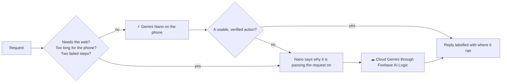

# PocketIDE™ Hybrid

**A coding IDE on an Android phone whose AI agent runs on the phone first.** Gemini Nano writes and fixes code on-device, free,
offline and in private. What the phone cannot do is handed to cloud Gemini, and every reply says which one answered. Both run
through **Firebase AI Logic** hybrid inference.

Entry for the [#BuildHybridAI 2026 hackathon](https://firebasehybridaihackathon.devpost.com/) (Android).

## Who it is for

For many people learning to code, a phone is the only computer they have. AI coding help usually asks for three things they may
not have: a subscription or an API key, a steady connection, and a willingness to send their code to a server. PocketIDE Hybrid
asks for none of them.

## What it does

- **Phone first, cloud when it matters.** Every chat, agent step and editor Quick assist goes to Gemini Nano first. A request
  that needs the web, is too long for the phone, or fails twice is passed to cloud Gemini, and Nano says why in the chat.
- **A real agent on a small model.** Nano answers with one action at a time; PocketIDE turns it into a real tool call (read,
  edit, run, check), verifies the result and puts a broken edit back. In the cloud, every tool is a Firebase AI Logic function call.
- **Tests decide.** For a Python bug, the app runs the failing test, Nano rewrites the function several times, and the first
  rewrite the test passes is kept. When Nano's rewrites fail, the cloud writes a short plan and Nano writes the code from it.
- **Private and offline.** Private mode never sends anything off the phone. In airplane mode, Nano still answers.
- **Apps you build get hybrid AI too.** A "Hybrid AI web app" starter uses the Firebase AI Logic web SDK in hybrid mode; inside
  PocketIDE's Preview, the page is answered by Gemini Nano on the phone with no setup.
- **Tuned without an update.** 31 Remote Config keys adjust Nano's instructions, sampling, thresholds and routing.

## Measured on a Galaxy S24+

Every number comes from the in-app benchmark: the real agent works unattended on the phone, and each task is checked by its
tests and by hidden checks the model never sees.

| Tasks | Where it ran | Result |
| --- | --- | --- |
| JavaScript coding tasks | Gemini Nano alone, on the phone | 114 of 132 (86%) |
| Real bug fixes from the Python libraries `rich` and `requests` | Nano first, with the cloud's help | 12 of 13; Nano wrote 10 of the 13 fixes on the phone |
| The same Python bugs | Nano alone, before the fix path was built | 1 of 13 |

Runs, failures and the fix each one led to are in [HYBRID-CHANGELOG.md](HYBRID-CHANGELOG.md).

## How a request is routed

Firebase products used: **AI Logic** (on-device Gemini Nano and cloud Gemini with function calling), **App Check**, **Remote
Config**, **Authentication** (anonymous), **Firestore**, **Crashlytics** and **Performance Monitoring**. The code that calls
Firebase AI Logic is in [`HybridAi.kt`](app/src/main/java/dev/pocketide/app/HybridAi.kt) and
[`HybridAgent.kt`](app/src/main/java/dev/pocketide/app/HybridAgent.kt).

## Try it

1. Install the judges' APK from **Releases** on an Android 8+ phone (a debug build, so allow installing from your browser).
2. On the welcome screen choose **Hybrid AI: Gemini Nano + cloud (recommended)**. No account or key is needed.
3. Ask for something, for example "Make a snake game in one HTML file", then open **Preview** to play it.

Gemini Nano needs a phone with Android AICore (recent Pixel and Galaxy S phones). Every other phone uses the cloud model
automatically, and the app says which.

## More

- [HACKATHON.md](HACKATHON.md): everything built during the hackathon with its files, the full routing diagram, the complete
  results, and how to set up your own Firebase project and build.
- [HYBRID-CHANGELOG.md](HYBRID-CHANGELOG.md): every change, with its reason and the benchmark run behind it.
- [docs/APP-GUIDE.md](docs/APP-GUIDE.md): the rest of PocketIDE (editor, terminal, git, previews, models), feature by feature.

PocketIDE existed before the hackathon as an IDE that needed a cloud API key. The repository's first commit is that app as it
was; everything after it was built during the submission period.

## Licence

Copyright 2026 Daniel Joseph Ball. The code is licensed under the Apache License, Version 2.0 (see [LICENSE](LICENSE));
third-party notices are in [NOTICE.md](NOTICE.md) and [LICENSES/](LICENSES/). Versions up to 1.5.221 were published under the
MIT licence.

PocketIDE™ and the PocketIDE icon are trademarks of Daniel Joseph Ball. The Apache licence covers the code, not the name or
icon; see [TRADEMARK.md](TRADEMARK.md). Website: [pocketide.app](https://pocketide.app) · Contact: help@pocketide.app
